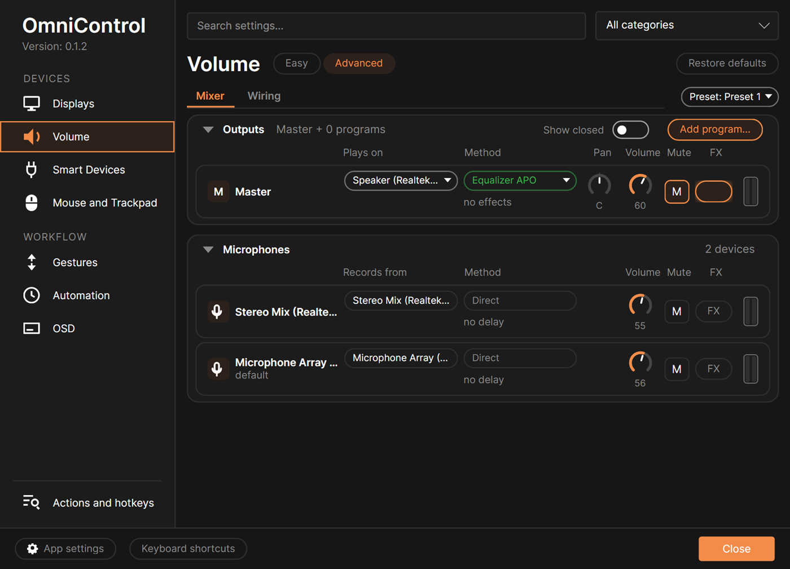
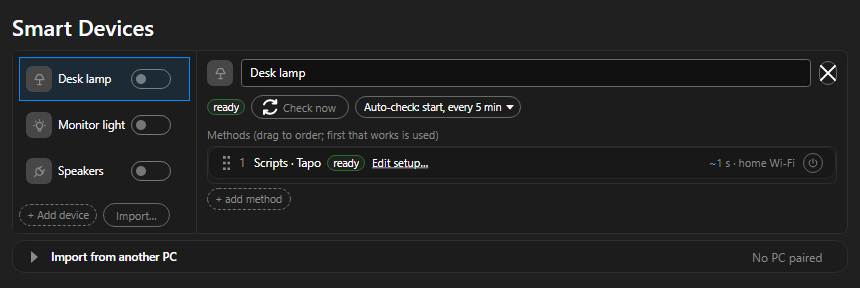
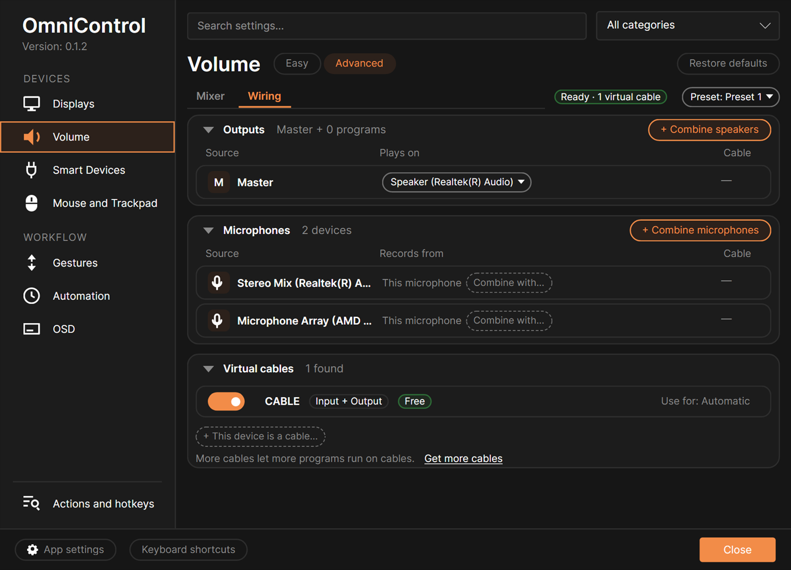
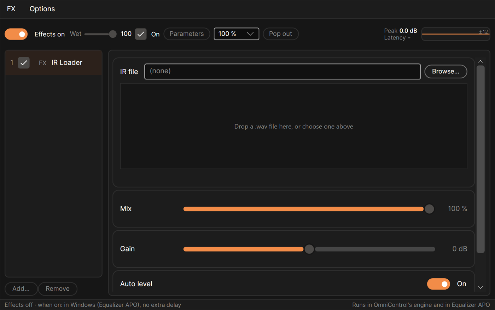
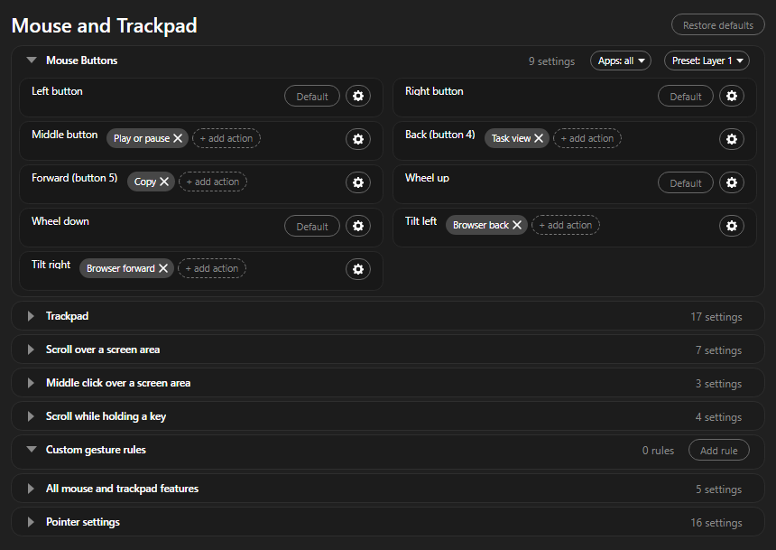
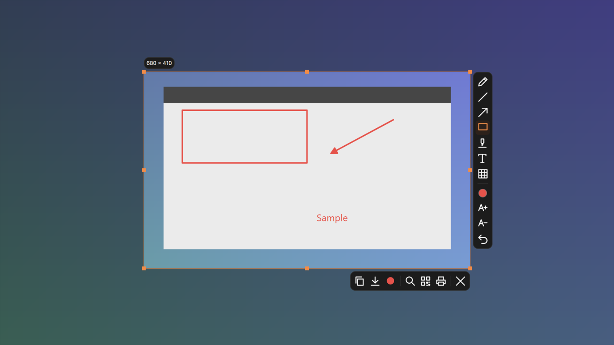
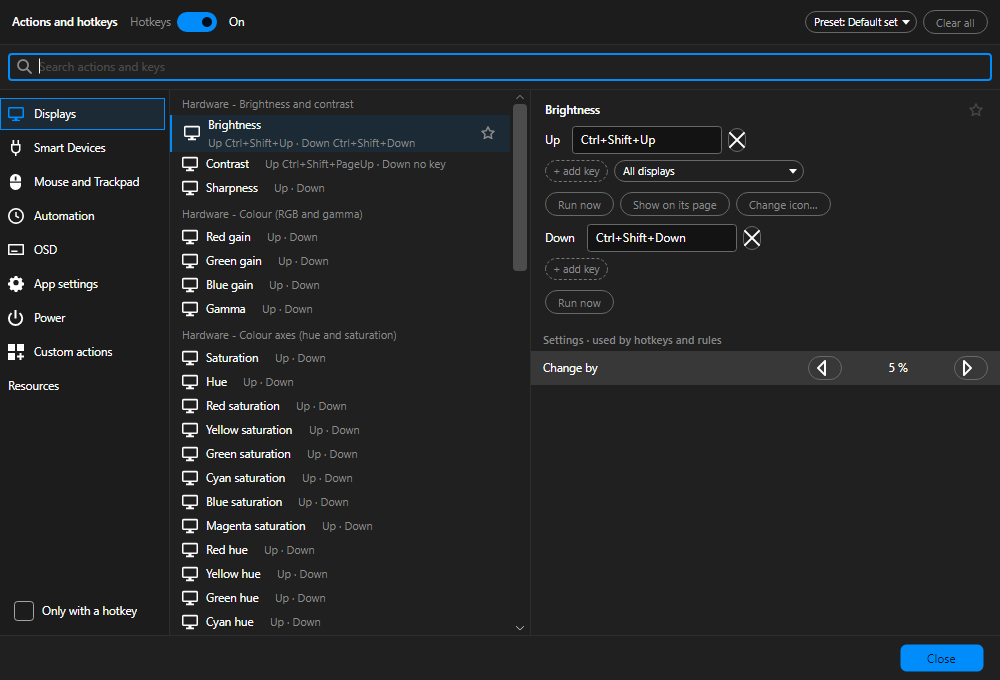
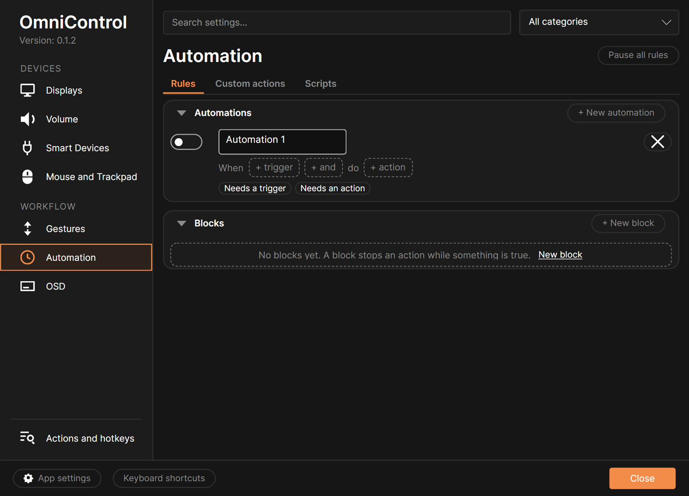

# OmniControl

One Windows app that controls your displays, sound, mouse, trackpad, smart plugs and screenshots, and wires any of them to any other.

**Everything is an action. Everything has a state.** Every feature registers its actions (brightness up, toggle a plug, rotate a screen, run a script) and its states (a plug is on, the master volume, on battery, the mouse layer) in one master list. Every action can get a hotkey in one **Actions and hotkeys** window, or be put on a mouse button, a trackpad gesture, a tray tile or an automation rule. Rules can start when a state changes or when another action runs, and the lists update as you add devices, scripts and custom actions.

> **Status: pre-release (0.1.x).** Expect rough edges. Much of it has been tested only on the developer's own PC. Where a feature is partial or experimental, this page says so.



## Features

### Smart home
- **Tapo and Kasa** plugs and bulbs over your local network through [python-kasa](https://github.com/python-kasa/python-kasa) (the *Scripts* method), with built-in Tapo and Kasa templates, Check now and Auto-check. Tapo was tested first.
- **Simulation** (experimental): drives the device's own phone app in an Android emulator (Android Studio, BlueStacks, LDPlayer, MuMu Player, MEmu). You record the taps, then *teach on and off* so OmniControl can read the state from the app's screen. The emulator runs hidden.
- One device can have **several methods** (for example Scripts, then Simulation). OmniControl tries them in order and falls through if one fails.



### Custom scripts and custom actions
- **Scripts**: PowerShell, CMD or Python saved inside OmniControl. Each one becomes a "Run script" action.
- **Custom actions**: run a command, script file, program, file, folder or web address. Every one is a normal action, so it can have a hotkey, a mouse button or a rule.

### Audio
- **Volume mixer**: per-app volume, pan and mute, an output device per app, input devices, live meters and knobs. There is an **Easy** view of guided goals and an **Advanced** view.
- **Per-app effects** run through a virtual cable or by recording the app. **Master effects** run through Equalizer APO, which OmniControl drives, or through a cable bus. **Combined devices** let you play on two speakers at once or join two microphones.
- **Effects**: parametric equaliser plus 32- and 16-band graphic EQs, compressor, limiter, gain, an IR loader, and **VST3 and VST2** plug-ins. Delay, noise gate and reverb can be added to a chain, but they are not processed yet, and the app says so. Works with virtual cables such as VB-CABLE, Hi-Fi Cable and Virtual Audio Cable.





### Displays
- **DDC/CI hardware controls** for each monitor: brightness, contrast, RGB gain, gamma, hue, saturation, colour preset, input source and more. Controls a monitor doesn't report are greyed out. Laptop backlight is included.
- **Software picture** for each display: brightness, contrast, gamma, colour temperature and RGB gain. Saturation, grayscale and invert apply to all displays. **Warm light at night** follows a schedule.
- **Rotation**: four "Rotate to…" actions with suggested Ctrl+Alt+arrow keys (bound only when you press "Suggest" on the action in Actions and hotkeys). **Presets** for hardware and for the software picture.


### Mouse and trackpad
- **X-Mouse-style remapping**: per-button, wheel and tilt actions, 10 layers, and **app scopes** (Only in… / All except… app lists) for a group or a single button.
- **Trackpad gestures** on a precision touchpad: three- and four-finger swipes, pinch, taps and double taps, with their own layers. While a gesture has an action, Windows' own gesture is turned off, and it is given back afterwards.
- **Wheel and middle-click gestures** over the taskbar, screen edges, title bars or desktop, plus "if … then …" custom rules.



### Screenshots and recording
- **Area editor in the style of Lightshot**: freezes every monitor and lets you resize the selection and draw on it (pen, arrow, rectangle, marker, text, blur). Then copy, save or print it.
- **Read QR code** on your PC. **Search image online** copies the picture and opens Google Lens; OmniControl uploads nothing itself.
- **Record an area** to MP4 (H.264/HEVC through Windows Media Foundation) or GIF, with optional system sound and microphone.



### Actions and hotkeys
- One three-pane window lists every action in the app. Search it by name or by pressing a key combination. An action can have several keys, keys can be grouped into shortcut sets, and each action has "Run now".



### Automation, OSD, tray, backup
- **Automation rules**: "When [trigger] and [condition] do [actions]". Triggers include time of day, a timer, idle, wake, battery, program start or close, USB connect, a hotkey, **any state change**, and **any action running**. **Blocks** stop an action while a condition holds. "Pause all rules" is always available.
- **OSD**: your own pop-up for volume, brightness and more. It can hide Windows' own OSD (best effort).
- **Tray quick panel**: a brightness slider for each screen and a volume slider with a speaker picker, plus tiles for smart devices, effects, night light, area screenshot, microphone mute, rotate and any action you add.
- **Backup and restore**: export or import settings, presets, shortcuts, rules, scripts and app lists, or wipe everything. There is also a preset manager for every preset group.




## One app instead of…

| Instead of | OmniControl does |
|---|---|
| Equalizer APO | **Doesn't replace it; it drives it.** OmniControl writes its master effects chain into your Equalizer APO setup. |
| Volume2 | Volume hotkeys, a custom OSD, and the wheel over the taskbar or screen edges |
| EarTrumpet | Per-app volume, mute and output device |
| SoundSwitch | *Partial*: pick the default speaker from the tray panel. There's no hotkey to cycle devices yet. |
| Lightshot | Area capture with an editor, then copy, save, print or search |
| ShareX / Snipping Tool | *Partial*: area, window, full-screen and all-screens capture, plus area recording to MP4 or GIF. No upload destinations or OCR. |
| QR code readers | Read QR code from a screen area, on the PC |
| Home Assistant | *Partial*: local control of Tapo and Kasa only (python-kasa), plus experimental app-driven control through an emulator |
| X-Mouse Button Control | Per-button actions, layers and app scopes |
| ClickMonitorDDC / Monitorian | DDC/CI brightness, contrast and colour for each monitor, with hotkeys and presets |
| f.lux / Night light | *Partial*: a scheduled warm-light colour temperature. No sunrise or sunset times. |
| iRotate | Rotate each display, with optional Ctrl+Alt+arrow keys |
| AutoHotkey | *Partial*: global hotkeys, scripts, custom actions and rules. No scripting language of its own. |

## Install

Download **Setup** (installer) or **Portable** (zip) from [GitHub Releases](https://github.com/cobhc95/OmniControl/releases). All releases are pre-releases. Both builds are self-contained, so you don't need to install .NET.

Setup installs OmniControl for all users into Program Files (Windows asks for administrator rights once); your settings stay your own, in `%APPDATA%\OmniControl`. It replaces an older per-user install (0.2.3 and earlier) by itself and keeps its settings. The network service (per-app network limits without running OmniControl as administrator) comes only with Setup: it runs as SYSTEM, so it runs only from a folder that only administrators can change. The Portable version does everything else, and does the network limits itself while it runs as administrator.

## Requirements

- Windows 10 or 11, x64. Recording a single app's sound needs Windows 10 version 2004 or later.
- Monitors need DDC/CI turned on in their own on-screen menu.
- Optional:
  - **Python and python-kasa**, for Tapo and Kasa through Scripts.
  - **An Android emulator**, for Simulation.
  - **Equalizer APO**, for master effects on the real speakers.
  - **A virtual audio cable**, for per-app and microphone effects.

## Build from source

Needs the .NET 9 SDK on Windows.

```powershell
dotnet run --project OmniControl.App -c Release
```

If you want to contribute, start with [AGENTS.md](AGENTS.md) and [MAP.md](MAP.md). See [CHANGELOG.md](CHANGELOG.md) for what changed in each release.

## Licence

GPL-3.0-or-later. See [LICENSE](LICENSE) and, for third-party components, [NOTICE.txt](NOTICE.txt).

---

Product names are trademarks of their owners; OmniControl is not affiliated with them.
