# OmniControl

One Windows app for your displays, sound, smart plugs, mouse, trackpad, other PCs and screenshots, where every feature is an action you can put on a hotkey, a button, a gesture, a tray tile or a rule.

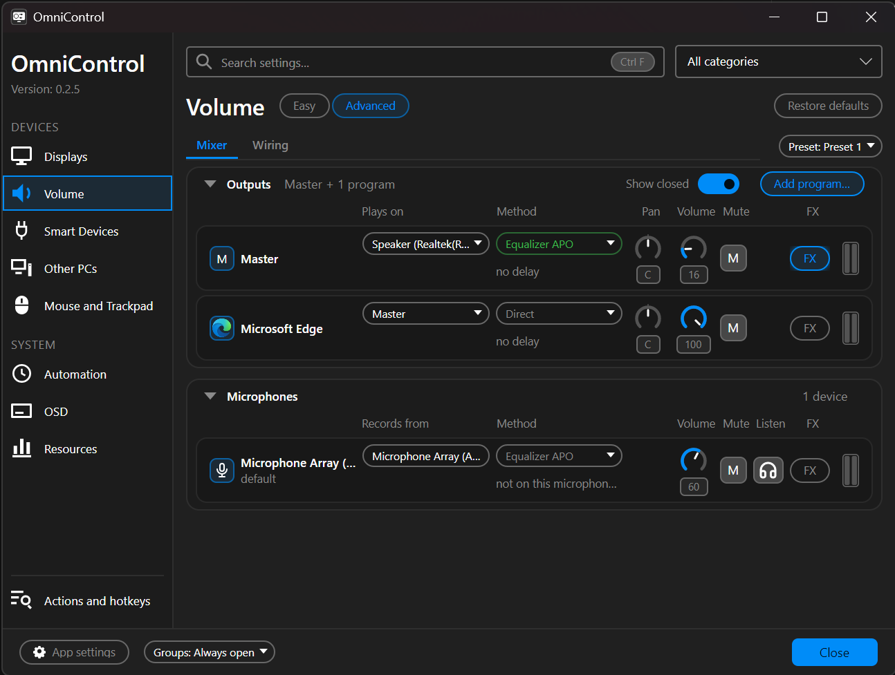

## What it does

- **Displays**: each monitor's own controls over DDC/CI (brightness, contrast, RGB gain, input source, colour preset and more) and the laptop backlight; a software picture per display (brightness, contrast, gamma, colour temperature); saturation, grayscale and invert for the whole desktop; warm light on a schedule; rotation; monitor and picture presets.
- **Volume**: per-app volume, pan, mute and output device, microphones, live meters; an Easy view with guided goals and an Advanced Mixer and Wiring view; volume presets.
- **Effects**: parametric and graphic EQs, compressor, limiter, gain, an impulse-response loader and VST3/VST2 plug-ins, per app, on the master and on microphones; they run in Equalizer APO (its official installer is included), through a virtual cable or by recording the app; combined speakers and microphones.
- **Smart devices**: Tapo and Kasa plugs and bulbs on your network through python-kasa, or (experimental) by tapping through the device's own phone app in an Android emulator; several methods per device, tried in order; automatic state checks.
- **Other PCs**: pair PCs on your network or over Tailscale, then run each other's shared actions, see their states and sound, wake them, and see and cancel a sleep or shut-down countdown; import settings or device set-ups from a paired PC.
- **Mouse and trackpad**: actions per button, wheel and tilt in 10 layers, limited to chosen apps; precision-touchpad gestures (three- and four-finger swipes, pinch, taps) with Windows' own gesture given back when unused; wheel and middle-click gestures over screen edges, the taskbar or title bars; custom gesture rules; pointer settings; actions sent as keys to a remote desktop.
- **Actions and hotkeys**: one window lists every action of every feature; system-wide hotkeys, shortcut sets, favourites and "Run now"; the same actions on buttons, gestures, tray tiles and rules.
- **Automation**: "When ... and ... do ..." rules (time, timer, idle, wake, battery, programs, USB devices, a hotkey, any state change, any action) and blocks that forbid actions while a condition holds; custom actions (command, script file, program, file, web address, keys); saved PowerShell, CMD and Python scripts; power actions with a cancellable countdown; keep awake.
- **OSD**: its own pop-up for volume, brightness and more, in five styles, on the screens and place you choose; it can hide Windows' own (best effort).
- **Resources**: live CPU, GPU, memory, disk, network and temperature readings; a taskbar gadget with ready-made layouts and the weather; network traffic control (per-app download and upload limits and blocks).
- **Screenshots**: a Lightshot-style area editor (pen, line, arrow, box, marker, text, blur) with copy, save and print; read a QR code; search the picture online; record an area to MP4 or GIF.
- **Tray panel**: brightness and volume sliders and tiles for smart devices, effects, night light, microphone mute, rotation or any action; optionally on Win+A.
- **App**: themes, accent and background colours, a preset manager, backup and restore, update check.

## Screenshots

<table>
<tr>
<td width="33%"><a href="docs/screenshots/displays.png">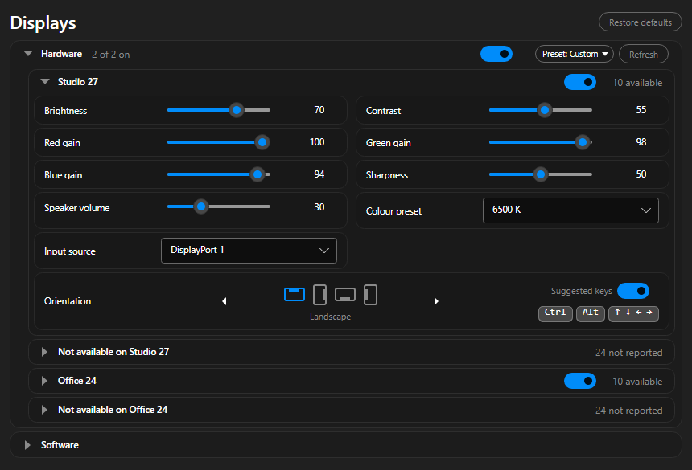</a> Displays: each monitor over DDC/CI</td>
<td width="33%"> Volume: mixer with effects per app</td>
<td width="33%"> Smart Devices</td>
</tr>
<tr>
<td> Mouse and Trackpad</td>
<td> Automation: rules and blocks</td>
<td> Actions and hotkeys</td>
</tr>
<tr>
<td><a href="docs/screenshots/action-picker.png">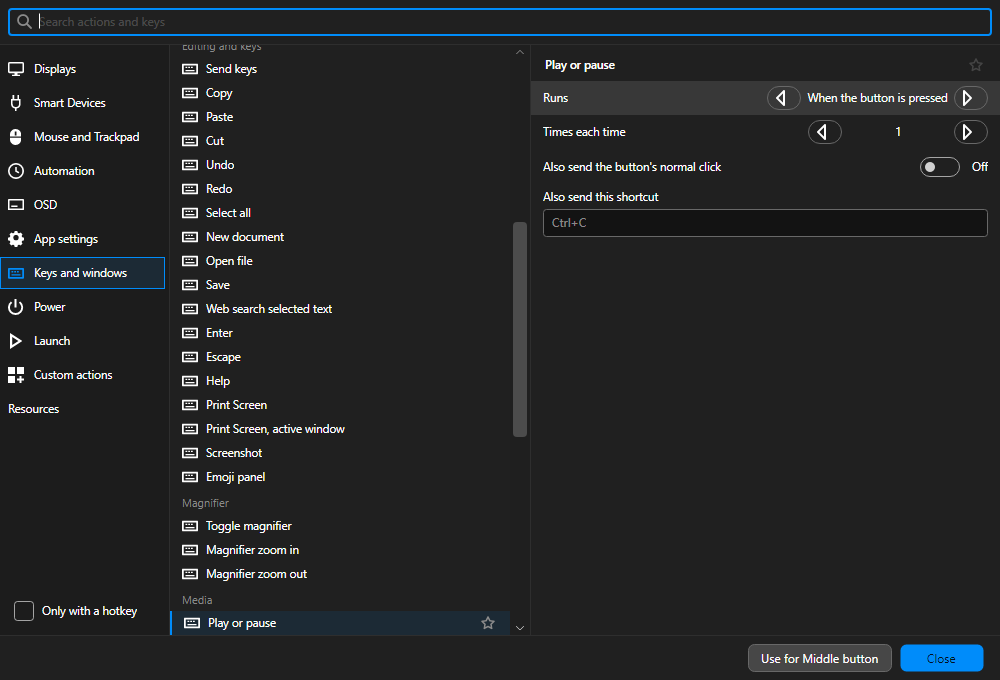</a> Choosing an action for a button</td>
<td><a href="docs/screenshots/osd.png">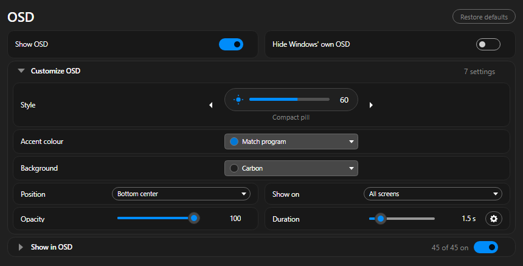</a> OSD settings</td>
<td><a href="docs/screenshots/osd-styles.png">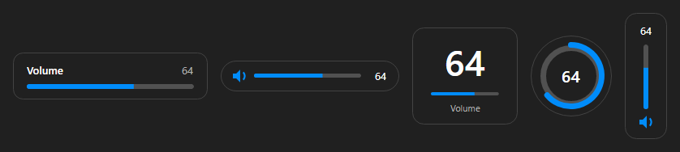</a> The OSD's five styles</td>
</tr>
<tr>
<td><a href="docs/screenshots/resources-gadget-tab.png">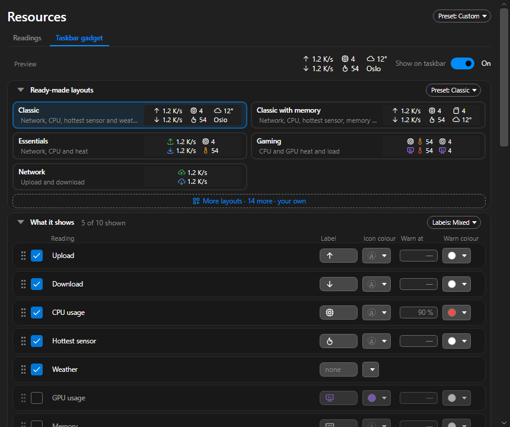</a> Resources: taskbar gadget settings</td>
<td><a href="docs/screenshots/taskbar-gadget.png">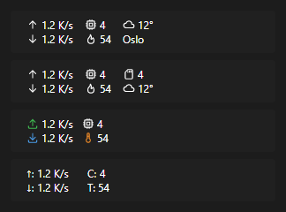</a> Taskbar gadget layouts</td>
<td><a href="docs/screenshots/tray-panel.png">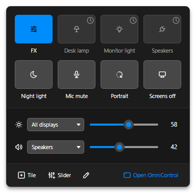</a> Tray quick panel</td>
</tr>
<tr>
<td><a href="docs/screenshots/app-settings.png">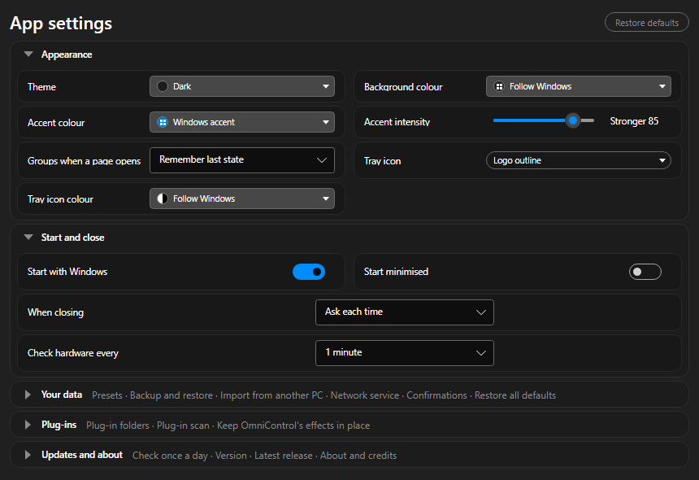</a> App settings</td>
<td><a href="docs/screenshots/displays-light.png">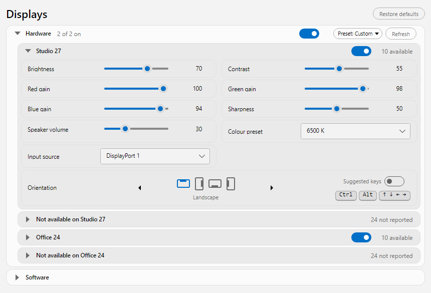</a> Light theme</td>
<td><a href="docs/screenshots/screenshot-tool.png">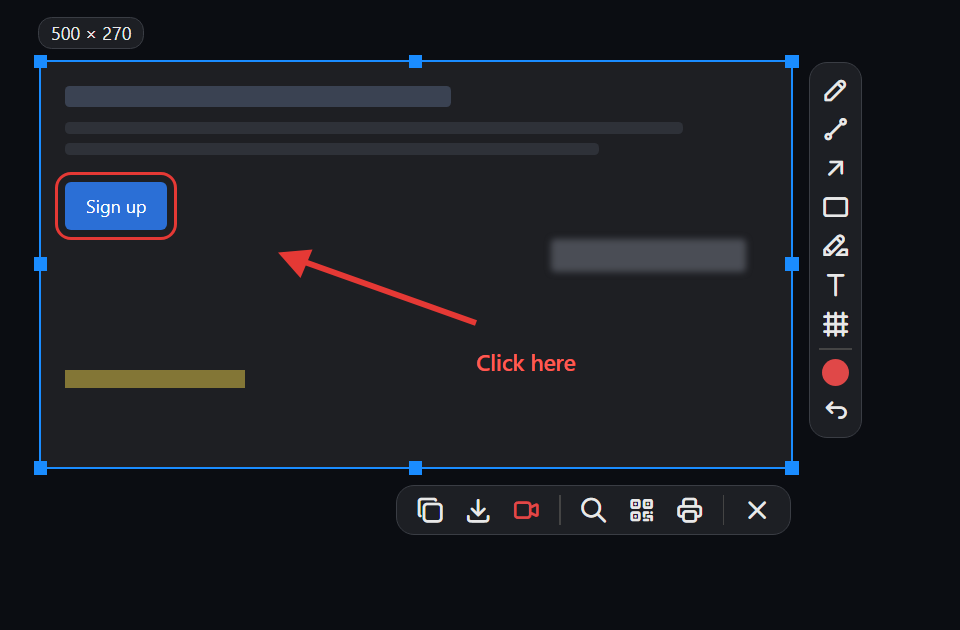</a> Screenshot tool (illustration)</td>
</tr>
<tr>
<td><a href="docs/screenshots/resources-readings.png">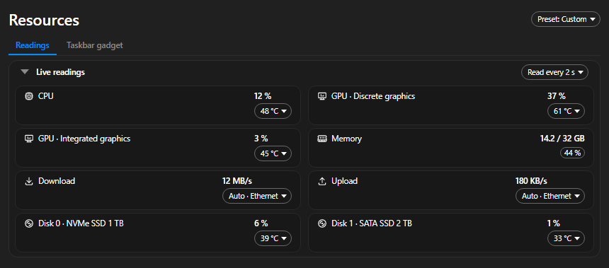</a> Resources: live readings</td>
<td><a href="docs/screenshots/network-traffic-control.png">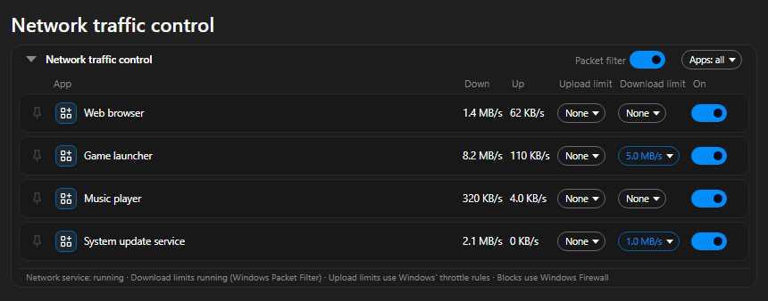</a> Network traffic control: speed and limit per app</td>
<td><a href="docs/screenshots/traffic-block.png">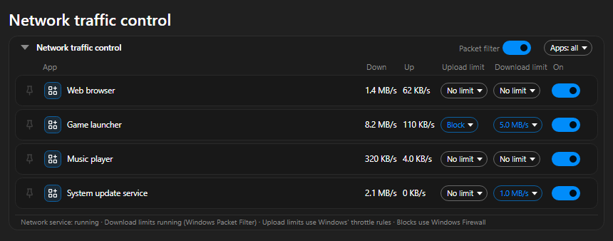</a> Block upload or download per app</td>
</tr>
<tr>
<td><a href="docs/screenshots/mouse-tap-hold.png">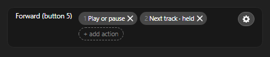</a> Tap or hold a mouse button for different actions</td>
<td><a href="docs/screenshots/action-runs-pulldown.png">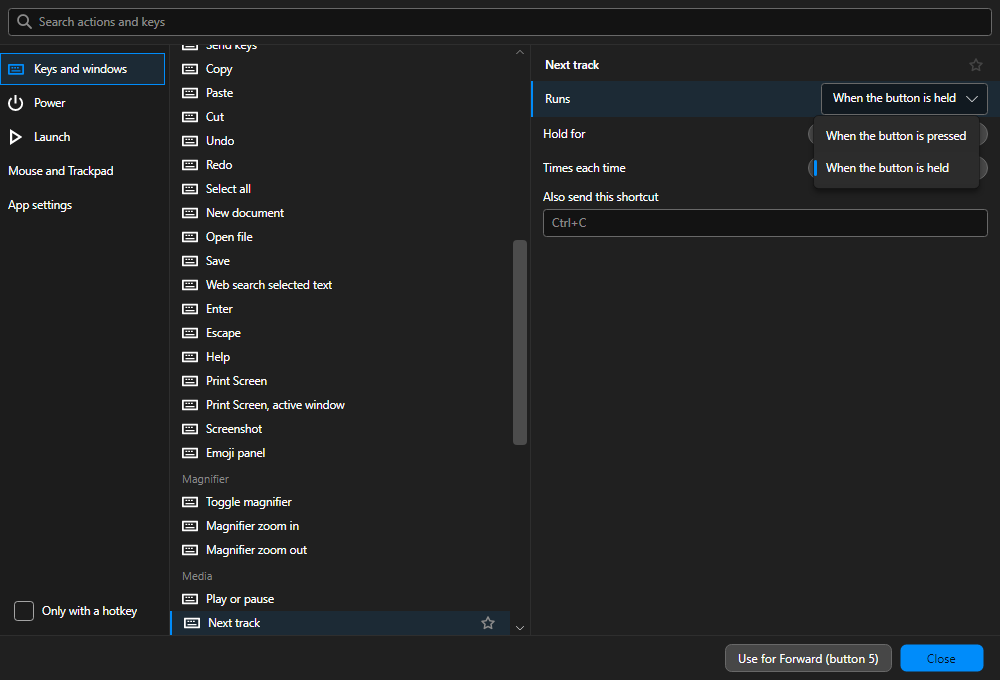</a> When an action runs: pressed, released, held…</td>
<td><a href="docs/screenshots/fx-measured.png">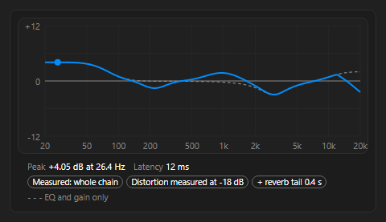</a> Effects chart measures the whole chain</td>
</tr>
<tr>
<td><a href="docs/screenshots/gadget-adapter.png">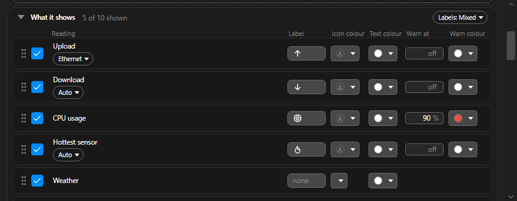</a> Taskbar gadget: choose the network adapter</td>
<td></td>
<td></td>
</tr>
</table>

The pictures are drawn from the app's own views with sample data by `tools/Screenshots`.

## Download

Get **Setup** (installer) or **Portable** (zip) from [Releases](../../releases). Both are self-contained (no .NET to install) and run on Windows 10 and 11, x64. Setup installs for all users and can add Equalizer APO, Windows Packet Filter (download limits) and the network service (network limits without running as administrator). Optional: Python with python-kasa for Tapo and Kasa, an Android emulator for the simulation method, a virtual audio cable for per-app and microphone effects.

To build it yourself: `dotnet run --project OmniControl.App -c Release` with the .NET 10 SDK. Contributors start with [AGENTS.md](AGENTS.md) and [MAP.md](MAP.md); [CHANGELOG.md](CHANGELOG.md) lists what changed.

## Licence

GPL-3.0-or-later ([LICENSE](LICENSE)); third-party components in [NOTICE.txt](NOTICE.txt). Product names are trademarks of their owners; OmniControl is not affiliated with them.
